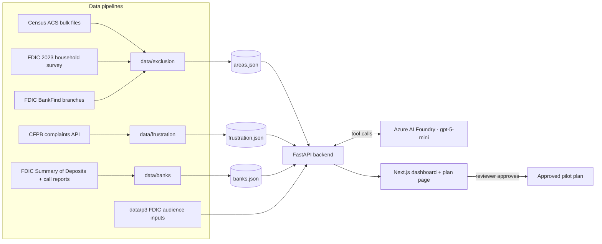

# Monopoly

**Where people are left out of banking, what frustrates them, whether a pilot pays, which bank to partner with, and an AI-drafted pilot plan a human approves.**

<!-- DEMO VIDEO: replace this block with the recording.
     Easiest: drag the .mp4 into this README while editing on github.com (GitHub hosts it and inserts the link),
     or paste a YouTube/Loom thumbnail link:  [](https://link-to-video) -->

> 🎬 **Demo video:** _coming soon_

**Live site:** https://ashy-desert-0ad29150f.3.azurestaticapps.net · Built for **LEAD ASPIRE 2026** at Microsoft Times Square, for the client **Mastercard**.

---

## The problem

LEAD ASPIRE 2026 paired our team with Mastercard. After discovery, our Statement of Work was approved by the EY partner, and we had a three-hour build before pitching to judges.

The question: **where should Mastercard launch an inclusive financial product, and how does it know the pilot is worth it?**

About 24.6 million US households are unbanked or underbanked (FDIC 2023), and about 1.3 billion adults worldwide have no account (World Bank Global Findex 2025). Deciding where to start is slow and manual, and it carries regulatory and reputational risk if targeting is done carelessly. Mastercard also doesn't hold accounts, so every pilot needs an issuer bank that sees a business case.

EY's recommendation, which shaped everything: **pilot first.** Prove it in one county, then scale to the state, the US and globally.

## What Monopoly does

1. **Underserved map.** Every state and all 3,144 counties scored on an exclusion index built from FDIC unbanked and underbanked rates, Census poverty, homes without internet, income and bank-branch density.
2. **Frustration map.** 20,811 CFPB complaints for New York (Aug 2024 to Jul 2026), placed in counties by ZIP and sorted into six topics: fees, fraud and scams, transfers, account closures, customer service, distrust. Each topic is matched to a pilot benefit (for example account closures → second-chance account).
3. **AI agent.** Ask "where should we pilot a no-fee account?" An Azure AI Foundry agent calls Monopoly's own data as tools, ranks areas, cites the numbers and highlights them on the map.
4. **ROI.** Unit economics per account, lifetime value versus churn, breakeven churn, and county → state → US → global scale. Every benchmark is sourced and shown in the app.
5. **Bank partners.** The top banks in any county by local deposits, a side-by-side comparison of 3 to 5 banks at their own debit pricing tier, and a pitch tailored to the bank you choose.
6. **Pilot plan.** Foundry drafts a 10-section plan from the facts only. A reviewer edits it, completes a safe-outreach checklist and approves it, then downloads it.

## How it works



- **Exclusion index:** mean z-score of the access measures, ranked as a 0-100 percentile within states or counties. County household counts are modeled from state FDIC rates and county poverty, and labeled as modeled.
- **Frustration:** complaint topics come from CFPB's own issue fields. Topic shares are shrunk toward the national mix (30-complaint prior). Pain = share versus national. The frustration score ranks complaints per 100k residents, and only areas with 30 or more complaints are scored; the rest are hatched as "not enough data".
- **Priority:** 0.5 × exclusion + 0.5 × frustration. Look-alike counties (at least 150 km away) become the comparison group for the pilot.
- **ROI:** swipe revenue + deposit earnings − fraud − servicing = annual margin. LTV = margin / churn. Breakeven churn = margin / acquisition cost. The audience can be all underserved households, unbanked only, or unbanked and interested in an account (FDIC survey).
- **AI guardrails:** tools are read-only. The plan prompt may use only the supplied facts. Every number in an AI answer is checked against the data. Protected-attribute terms and "network volume = revenue" wording are flagged. Nothing is final until a person approves.

## How we got here (iterations)

1. **National exclusion layer.** The Census API started requiring a key, so we switched to Census's keyless bulk summary files. FDIC's 2023 appendix gave real state unbanked and underbanked rates, so nothing had to be modeled at state level.
2. **Pilot-first data pivot.** The complaint layer narrowed to New York. The first snapshot covered one month with sentiment scores but no topics. CFPB doesn't publish complaint text in its API for this window, so we rebuilt it over 24 months using CFPB's issue categories. We fixed a mapping bias along the way that made every county look like "transfers".
3. **Foundry agent and pilot plan.** We tested the agent with varied prompts and tightened it each round: a fixed refusal for protected-attribute requests, plain wording instead of field names, correct "volume is not revenue" language, and a number check that catches invented figures.
4. **Sourcing every number.** An audit found ROI inputs without citations. Each was traced to the Federal Reserve, FDIC, PULSE, Moebs, FirstPage Sage, the Mastercard 10-K or the Global Findex. Values changed where a source disagreed, which moved breakeven churn from 16.1% to 8.8%. We kept that harder number.
5. **Bank partners.** We added FDIC branch deposits and call reports, so the question "which issuer do we approach?" has data behind it.
6. **Hosting.** We first prepared a GitHub Pages build, then moved to Azure: Static Web Apps for the frontend and App Service for the API, deployed by GitHub Actions with keyless OIDC sign-in. The Foundry key lives only in App Service settings, and AI calls are rate limited per visitor.

## Built with

| Layer | Tech |
|---|---|
| Frontend | Next.js 16 (App Router), TypeScript, Tailwind, SVG map with d3-geo + topojson + us-atlas |
| Backend | FastAPI, Python 3.11, pydantic v2, NumPy |
| AI | **Azure AI Foundry** (Azure OpenAI v1 endpoint, `gpt-5-mini`) with tool calling |
| Data | Census ACS 2020-2024, FDIC household survey 2023, FDIC BankFind and Summary of Deposits 2026, FDIC call reports Q2 2026, CFPB Consumer Complaint Database, Census Gazetteer and ZCTA crosswalk |
| Hosting | **Azure Static Web Apps** (frontend) + **Azure App Service** (API), deployed by **GitHub Actions** CI/CD (lint, tests, build, OIDC deploy, health checks) |
| Tooling | GitHub, pytest, ESLint |

## Why it's different

- **One flow from question to decision.** Where people are left out, what they complain about, whether it pays, which bank to approach, and a plan ready for approval, instead of five separate analyses.
- **Honest numbers.** Every figure is sourced or tagged "modeled" or "placeholder", and the sources are listed in the app. It shows where a pilot does **not** pay (a large-bank issuer loses money at any churn), because that's what makes the rest credible.
- **Responsible targeting by design.** No race, ethnicity, citizenship, national origin, language or religion data is used anywhere. Targeting is by economic access and complaint topics only, and outreach goes through community partners with issuer compliance review.
- **AI that drafts and a human who decides.** The agent can only use Monopoly's data, guardrails flag anything it can't trace, and approval needs a named reviewer and a completed checklist.
- **Built to measure.** Each plan includes a look-alike comparison group, a 6-month read and a scale / rework / drop rule, so the pilot produces evidence rather than anecdotes.

## Run it locally

Prerequisites: Python 3.11+, Node 20+, and a Foundry endpoint and key (the app falls back to rules and templates without them).

```bash
cp .env.example backend/.env
```

Add your Foundry endpoint and key to `backend/.env`. Then start the backend from `backend/`:

```bash
pip install -r requirements.txt
```

```bash
python -m uvicorn app.main:app --host localhost --port 8000
```

And the frontend from `frontend/` (copy `.env.local.example` to `.env.local` and set `NEXT_PUBLIC_USE_MOCK=0`):

```bash
npm install
```

```bash
npm run dev
```

Open http://localhost:3000. Tests: `pytest -q` in `backend/`.

**Rebuild the data:** `data/exclusion/` (fetch.py, then build.py), `data/frustration/build_ny.py`, `data/banks/build_banks.py`. Each folder has a README with sources, method and limits.

**Deploy:** open a pull request to `main`. CI checks the frontend and backend, and merging deploys to Azure. Details in [docs/deploy.md](docs/deploy.md).

## Limits we state openly

- County unbanked and underbanked rates are state-level. County underserved counts are modeled.
- The frustration layer covers New York so far and measures complaint volume, not severity (complaint text wasn't available to classify).
- Bank rankings use deposits as a proxy for customers. Credit unions aren't included, and a bank's card network isn't public.
- Churn and adoption are placeholders the pilot is meant to measure.

## Repository map

| Path | What |
|---|---|
| `frontend/` | Next.js dashboard, area profile, ROI panel, bank comparison, chat, plan page |
| `backend/app/` | API, services (merge, recommend, look-alikes, ROI, banks), Foundry agent and plan (`ai/`) |
| `data/exclusion/`, `data/frustration/`, `data/banks/`, `data/p3/` | Data pipelines and inputs |
| `CONTRACTS.md` | API and data contracts |
| `docs/deploy.md`, `.github/workflows/azure.yml` | Hosting guide and CI/CD pipeline |

## Team

<!-- Fill in names and roles -->
| Name | Role |
|---|---|
| | |

_Prototype for LEAD ASPIRE 2026. Modeled data; not financial advice. No protected attributes are used._
